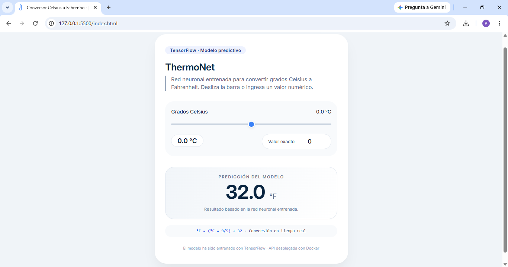
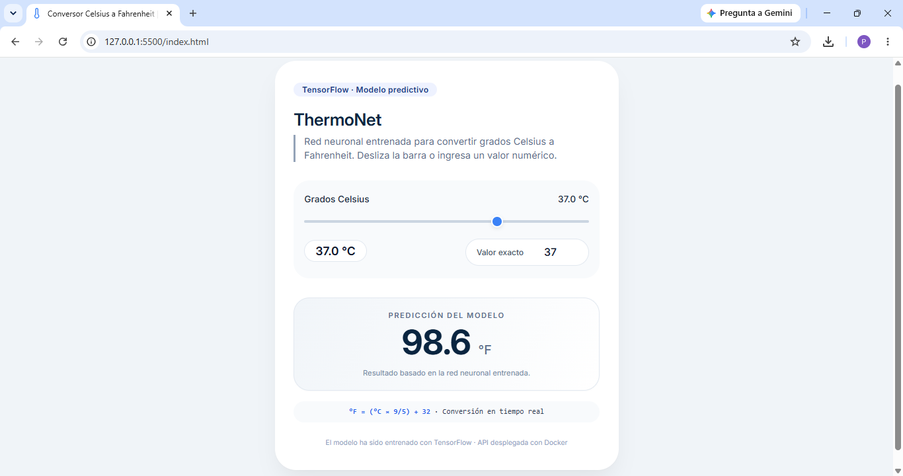
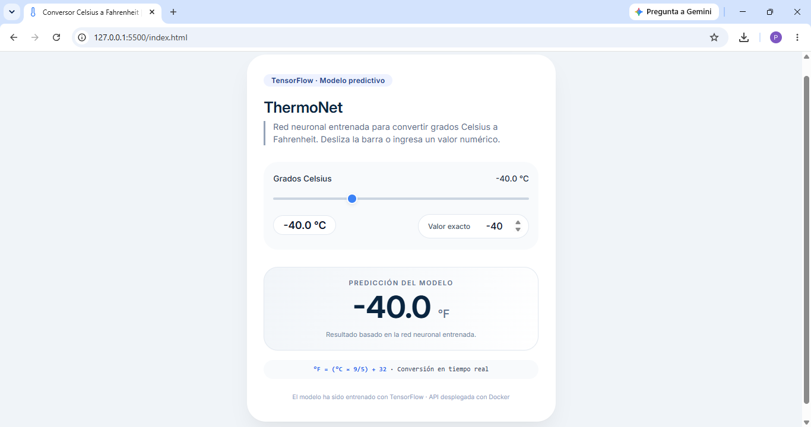
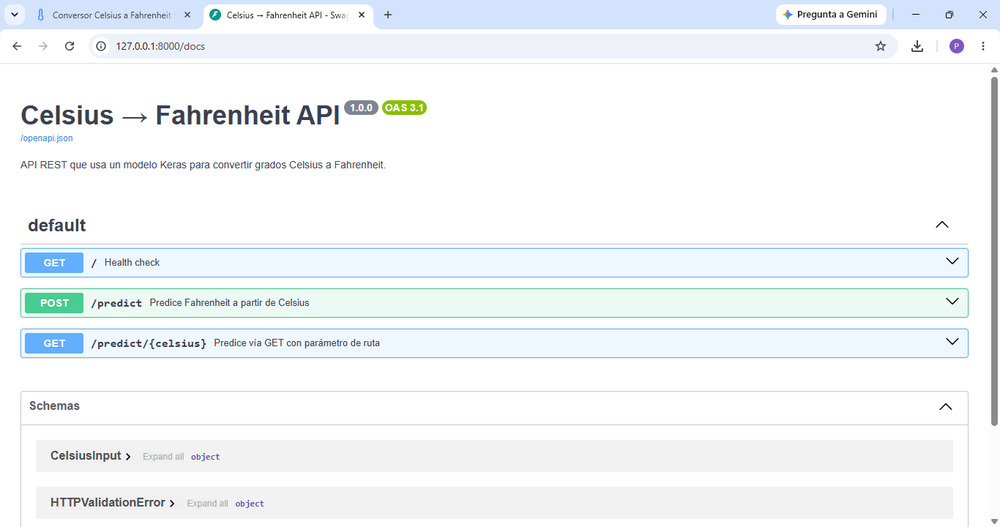
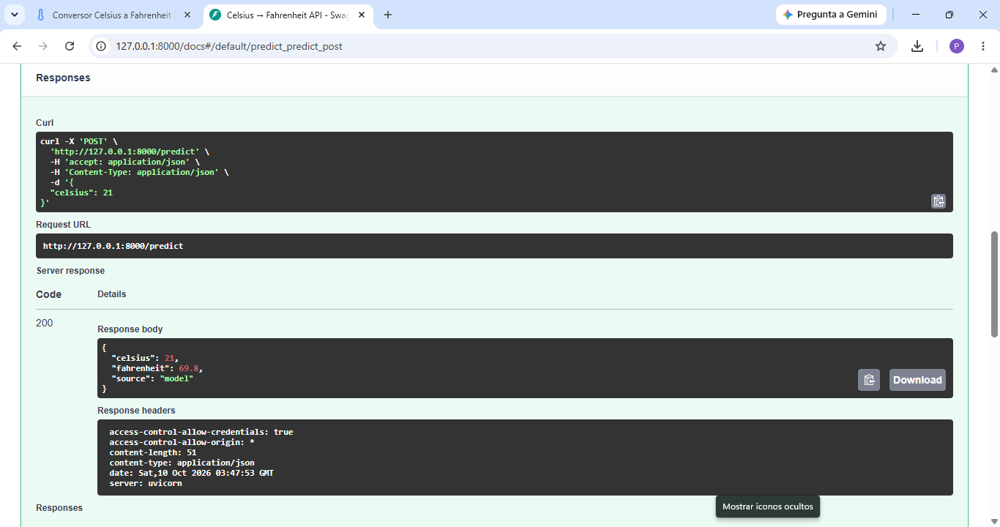

# ThermoNet — Celsius to Fahrenheit Converter with AI

A temperature converter powered by a **neural network** trained with TensorFlow/Keras. The model is exposed through a **REST API built with FastAPI**, and a web page lets you slide a bar or type a value in °C to see the prediction in °F in real time.

---

## English

### Features

- **Keras model** that learns the °C → °F conversion.
- **REST API** with FastAPI (`POST` and `GET` endpoints) and interactive Swagger documentation.
- **Fallback mode:** if the model fails to load, the API responds with the mathematical formula and indicates the source (`model` or `formula`).
- **Web interface** with a slider (from -100 °C to 100 °C) and a numeric input, with real-time prediction.
- **Docker container** to run the API without installing dependencies.

### The model

| Feature | Detail |
| ------- | ------ |
| Input | 1 value (degrees Celsius) |
| Architecture | `Dense(3)` → `Dense(3)` → `Dense(1)`, all with linear activation |
| Trainable parameters | 22 |
| Optimizer / loss | Adam / mean squared error (MSE) |

Since the relationship between the scales is linear (°F = °C × 9/5 + 32), the model uses linear layers.

#### Results

The model output was compared against the exact formula on 401 values between **-50 °C and 150 °C**:

| Metric | Value |
| ------ | ----- |
| Mean error | < 0.0001 °F |
| Maximum error | 0.0001 °F |

Examples:

| °C | Model (°F) | Formula (°F) |
| -- | ---------- | ------------ |
| -40 | -40.0000 | -40.0 |
| 0 | 32.0000 | 32.0 |
| 21 | 69.8000 | 69.8 |
| 37 | 98.6000 | 98.6 |
| 100 | 212.0000 | 212.0 |

### API

| Method | Route | Description |
| ------ | ----- | ----------- |
| `GET` | `/` | Service and model status |
| `POST` | `/predict` | Receives `{"celsius": 21}` and returns the prediction |
| `GET` | `/predict/{celsius}` | Same, passing the value in the route |

**Example response:**

```json
{
  "celsius": 21.0,
  "fahrenheit": 69.8,
  "source": "model"
}
```

Interactive documentation (Swagger UI) is available at `http://localhost:8000/docs`.

### Screenshots

**Interface**


**Model predictions**



**API documentation**


**API test**


### How to run it

**1. Clone the repository**

```bash
git clone https://github.com/KPVE2004/thermonet.git
cd thermonet
```

**2. Start the API (from the `api` folder)**

*Option A — Local:*

```bash
cd api
python -m venv venv
venv\Scripts\activate          # On macOS/Linux: source venv/bin/activate
pip install -r requirements.txt
python -m uvicorn main:app --reload
```

*Option B — Docker:*

```bash
cd api
docker build -t thermonet-api .
docker run -p 8000:8000 thermonet-api
```

The API will be available at `http://localhost:8000`.

**3. Open the interface**

With the API running, open `index.html` in your browser (double-click, or use the *Live Server* extension in VS Code).

### Project structure

```
├── api/
│   ├── main.py                    # FastAPI application
│   ├── Dockerfile
│   ├── requirements.txt
│   └── modelo_GCtoGFV2.keras      # Trained model
├── docs/                          # Application screenshots
└── index.html                     # Web interface
```

### Tech stack

Python · TensorFlow / Keras · FastAPI · Uvicorn · NumPy · Docker · HTML5 · CSS3 · JavaScript

---

## Español

Conversor de temperatura cuya conversión la realiza una **red neuronal** entrenada con TensorFlow/Keras. El modelo se expone mediante una **API REST con FastAPI** y una página web permite deslizar una barra o escribir un valor en °C para ver la predicción en °F en tiempo real.

### Características

- **Modelo Keras** que aprende la conversión °C → °F.
- **API REST** con FastAPI (endpoints `POST` y `GET`) y documentación interactiva con Swagger.
- **Modo de respaldo:** si el modelo no puede cargarse, la API responde con la fórmula matemática e indica la fuente (`model` o `formula`).
- **Interfaz web** con barra deslizante (de -100 °C a 100 °C) y campo numérico, con predicción en tiempo real.
- **Contenedor Docker** para levantar la API sin instalar dependencias.

### El modelo

| Característica | Detalle |
| -------------- | ------- |
| Entrada | 1 valor (grados Celsius) |
| Arquitectura | `Dense(3)` → `Dense(3)` → `Dense(1)`, todas con activación lineal |
| Parámetros entrenables | 22 |
| Optimizador / pérdida | Adam / error cuadrático medio (MSE) |

Como la relación entre las escalas es lineal (°F = °C × 9/5 + 32), el modelo usa capas lineales.

#### Resultados

Se comparó la salida del modelo contra la fórmula exacta en 401 valores entre **-50 °C y 150 °C**:

| Métrica | Valor |
| ------- | ----- |
| Error medio | < 0.0001 °F |
| Error máximo | 0.0001 °F |

Ejemplos:

| °C | Modelo (°F) | Fórmula (°F) |
| -- | ----------- | ------------ |
| -40 | -40.0000 | -40.0 |
| 0 | 32.0000 | 32.0 |
| 21 | 69.8000 | 69.8 |
| 37 | 98.6000 | 98.6 |
| 100 | 212.0000 | 212.0 |

### API

| Método | Ruta | Descripción |
| ------ | ---- | ----------- |
| `GET` | `/` | Estado del servicio y del modelo |
| `POST` | `/predict` | Recibe `{"celsius": 21}` y devuelve la predicción |
| `GET` | `/predict/{celsius}` | Lo mismo, pasando el valor en la ruta |

**Ejemplo de respuesta:**

```json
{
  "celsius": 21.0,
  "fahrenheit": 69.8,
  "source": "model"
}
```

La documentación interactiva (Swagger UI) queda disponible en `http://localhost:8000/docs`.

### Capturas

**Interfaz**


**Predicciones del modelo**


**Documentación de la API**


**Prueba de la API**


### Cómo ejecutarlo

**1. Clonar el repositorio**

```bash
git clone https://github.com/KPVE2004/thermonet.git
cd thermonet
```

**2. Levantar la API (desde la carpeta `api`)**

*Opción A — Local:*

```bash
cd api
python -m venv venv
venv\Scripts\activate          # En macOS/Linux: source venv/bin/activate
pip install -r requirements.txt
python -m uvicorn main:app --reload
```

*Opción B — Docker:*

```bash
cd api
docker build -t thermonet-api .
docker run -p 8000:8000 thermonet-api
```

La API quedará en `http://localhost:8000`.

**3. Abrir la interfaz**

Con la API corriendo, abre `index.html` en el navegador (doble clic, o con la extensión *Live Server* de VS Code).

### Estructura del proyecto

```
├── api/
│   ├── main.py                    # API con FastAPI
│   ├── Dockerfile
│   ├── requirements.txt
│   └── modelo_GCtoGFV2.keras      # Modelo entrenado
├── docs/                          # Capturas de la aplicación
└── index.html                     # Interfaz web
```

### Tecnologías

Python · TensorFlow / Keras · FastAPI · Uvicorn · NumPy · Docker · HTML5 · CSS3 · JavaScript

---

## Author · Autora

**Katia Paola Victoria Escalera**

[GitHub](https://github.com/KPVE2004) · [LinkedIn](https://www.linkedin.com/in/katia-paola-victoria-escalera-148688442/) · [Email](mailto:kp_victoria08@hotmail.com)
